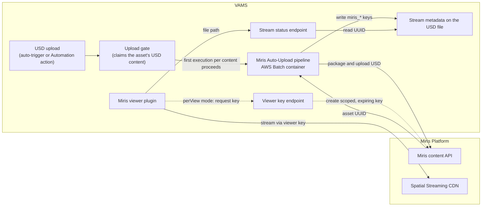

# Miris Spatial Streaming Integration

[Miris Spatial Streaming](https://miris.com) delivers 3D geometry progressively: an asset loads at a lower fidelity first and sharpens to full quality within seconds, much as a video stream does. VAMS integrates with Miris so that USD assets can be uploaded to Miris and then streamed directly inside the VAMS web viewer, without downloading the full geometry to the browser.

---

## How VAMS Integrates with Miris

The integration has two halves that work together:

-   **The Miris viewer plugin** renders Miris-hosted assets in the VAMS file viewer. When a user opens a USD file, the viewer streams the Miris asset recorded in that file's [stream metadata](#stream-metadata).
-   **The Miris Auto-Upload pipeline** uploads supported USD source assets to Miris, waits for processing, and records the resulting Miris asset as file metadata on the source USD file. See the [Miris Auto-Upload Pipeline](../../pipelines/miris-upload.md) for the pipeline details.

The end-to-end flow is: a USD asset is uploaded to Miris (automatically on file upload, or on demand through the file manager's **Automation** action) → Miris processes it into a streamable asset → the Miris asset UUID is written to the metadata of the asset's root USD file → the viewer streams the asset when a user opens the USD file. The stream metadata can also be set by hand, for example to point a USD file at an asset that is already on Miris.

:::info
Miris integration is optional and does not affect core VAMS functionality. Miris is a service on the public internet, so the integration cannot be enabled when `app.govCloud.enabled` is `true`, as the restricted partitions (AWS GovCloud (US), AWS European Sovereign Cloud, and the ISO partitions) require. It also requires the `unsafe-eval` Content Security Policy directive (see [Requirements](#requirements-and-limitations)).
:::

---

## Viewer plugin

VAMS includes one Miris viewer plugin for USD files.

| Plugin ID             | Extensions                        | Priority | Feature flags                           | Role                                                                |
| --------------------- | --------------------------------- | -------- | --------------------------------------- | ------------------------------------------------------------------- |
| `miris-stream-viewer` | `.usd`, `.usda`, `.usdc`, `.usdz` | 0        | `MIRIS_STREAMING` and `ALLOWUNSAFEEVAL` | Streams the Miris asset recorded in the USD file's stream metadata. |

The plugin's `viewerConfig.json` entry sets `autoSelect: true`, so when it is the only USD viewer at the lowest priority (`0`) it opens automatically instead of waiting for the user to choose; other USD viewers, such as the Needle USD Viewer, remain in the viewer selector. When a USD file is opened, the plugin calls the [stream status endpoint](../../api/miris.md) with the file's object key and acts on the result:

-   **The file has no Miris asset UUID**: shows a "Not yet streamed with Miris" note. The note suggests the **Needle USD Viewer (Experimental)** for viewing the file now, and the file manager's **Automation** action, which runs the auto-registered **Miris Spatial Streaming Upload** workflow (`miris-upload`) on the file, for streaming it. The viewer does not start an upload itself.
-   **Miris is still preparing the asset**: shows a "preparing" overlay (processing typically takes 1–2 hours after upload) and refreshes automatically when the asset becomes streamable.
-   **The asset is streamable, or Miris could not be queried**: streams the asset with a viewer key, with `miris_display_name` as the overlay label. In `static` mode the key is the deployment's viewer key; in [`perView` mode](#per-view-viewer-keys) the viewer first requests a key from VAMS, and shows an error instead of the stream if the request is denied (`403`) or fails. The status check is advisory and does not block streaming.
-   **The Miris asset is not bound to this VAMS asset** (`perView` mode): the Miris asset lacks one of the [binding tags](#binding-tags), or Miris reports that it has no such asset because it was deleted or is not visible to the Integration Key's workspace. Shows an error that names both tags instead of the stream.
-   **The stored UUID is not a valid UUID, or Miris reports a processing failure**: shows an error message instead of the stream.

Each error message offers a **Retry** button that loads the stream again, starting with the status check.

When the file records the Amazon S3 version it was streamed from (`miris_source_version_id`) and that version differs from the version being viewed, the viewer streams the recorded asset and shows a banner: "This stream was built from a different version of this file. Run the Miris Spatial Streaming Upload workflow again to update it." When neither a file version nor an asset version is selected, the viewer compares against the file's current version; viewing a historical asset version without a file version shows no banner. A file without a recorded source version, which is typical of hand-edited metadata, shows no banner.

When a historical asset version is viewed, the viewer streams the Miris asset recorded in the file's current metadata, not in the version's metadata snapshot (see the [Miris API Reference](../../api/miris.md)).

The viewer reads the UUID through the status endpoint, never by downloading files, so streaming works for assets marked non-distributable. Per-asset access authorization still applies, and viewing a stream does not require access to the file metadata routes.

---

## Web SDK

The viewer renders with the Miris web SDK, which VAMS bundles from three npm packages: `@miris-inc/components` (the `<miris-scene>`, `<miris-camera>` and `<miris-stream>` elements the viewer renders), `@miris-inc/three` and `@miris-inc/core` (the streaming engine). All three are pinned to the same exact version, `0.0.8-d3cdf31`, in `web/package.json`, because `@miris-inc/core` is pinned exactly by its siblings and the packages publish in lockstep. Upgrade them together. The packages ship their own TypeScript declarations, and the application's `three` dependency is `^0.185.1`, inside the SDK's supported range. Installs honor the repository's npm `min-release-age = 7` setting (`web/.npmrc`), so a new SDK release becomes installable only after it is seven days old. The age is checked per package, and `@miris-inc/core` can publish hours after the other two, so check the publish time of all three before choosing a build.

### Rendering

The viewer loads the SDK only after the status check reports a stream to open, so a file that is not streamed never loads it. The SDK renders with WebGPU where the browser grants a WebGPU adapter. When it does not, the viewer selects the SDK's WebGL 2 engine before the first scene mounts. A device with neither shows "Miris streaming is not supported on this device" instead of a blank panel. Browsers that grant a WebGPU adapter need no WebGL 2 context.

Miris assets in the GES format need WebGPU. On a browser without a WebGPU adapter the viewer still opens them, and the SDK shows its own message that the asset needs WebGPU in place of the stream. Other assets stream with the WebGL 2 engine.

### Content Security Policy

With `app.miris.enabled`, the Content Security Policy gains `blob:` in `script-src` and `https://*.miris.com` and `wss://*.miris.com` in `connect-src`. The SDK also needs `'unsafe-eval'` (from `app.webUi.allowUnsafeEvalFeatures`) and `'wasm-unsafe-eval'` in `script-src`, which the base policy carries. The web distribution serves the SDK's `.wasm` files as `application/wasm`. See [Security](../../architecture/security.md#content-security-policy-csp) for the policy as a whole.

### Troubleshooting

-   **The panel shows "Miris streaming is not supported on this device"**: the browser grants neither a WebGPU adapter nor a WebGL 2 context, or the WebGL 2 engine could not compile its shaders. Enable hardware acceleration, or use a supported browser.
-   **The SDK reports that WebGPU is required**: the asset is a GES asset and the browser grants no WebGPU adapter. Open it in a browser that supports WebGPU, such as a current Chrome or Edge, with hardware acceleration enabled.
-   **"The Miris asset recorded for this file is not linked to this VAMS asset"** (`perView` mode): add the two [binding tags](#binding-tags) to the Miris asset, or run the **Miris Spatial Streaming Upload** workflow on the file again. The error also appears when Miris reports that it has no such asset: it was deleted, or it is not visible to the Integration Key's workspace.
-   **"The Miris viewer failed to load"**: the viewer waits 60 seconds for the SDK to load and then stops. Check the Network tab for blocked or stalled SDK and `.wasm` requests and the console for CSP violations.
-   **"Timed out waiting for Miris to start streaming"**: the stream sends no first frame within 60 seconds. An invalid or wrong-workspace viewer key and a blocked `*.miris.com` connection also surface this way, because they fire no event.

## Stream metadata

The Miris stream for a USD file is described by four keys in that file's metadata:

| Key                       | Type     | Meaning                                                                                                                                   |
| ------------------------- | -------- | ----------------------------------------------------------------------------------------------------------------------------------------- |
| `miris_asset_uuid`        | `string` | Miris asset to stream. The only key the viewer requires; a missing or empty value means the file is not streamed.                         |
| `miris_source_version_id` | `string` | Amazon S3 version ID of the USD file the stream was made from. Empty when the bucket is unversioned. Drives the different-version banner. |
| `miris_uploaded_at`       | `date`   | When the Miris upload completed (ISO 8601 UTC, for example `2026-10-14T09:30:00Z`).                                                       |
| `miris_display_name`      | `string` | Label shown over the stream in the viewer. The upload pipeline sets it to the name of the Miris asset.                                    |

The [upload pipeline](../../pipelines/miris-upload.md#what-the-pipeline-writes) writes all four keys on the asset's root USD file, the one no other USD layer in the asset references (see [How the root is chosen](../../pipelines/miris-upload.md#how-the-root-is-chosen)). The keys do not begin with `VAMS_` or `_`, so they are indexed for search like any other metadata.

### Miris stream metadata schema

When `app.miris.enabled` is `true`, deployment seeds a GLOBAL `fileMetadata` schema named **Miris stream** (ID `miris-stream-file-schema`). It defines the four keys as optional fields with the types above and applies to files with the extensions `.usd`, `.usda`, `.usdc`, and `.usdz`. The fields appear in the file metadata editor for every USD file, whether or not the file has been streamed.

The schema record is written by a deployment custom resource:

-   It is written again on every deployment, so edits made to the **Miris stream** schema in the web interface, including disabling it, are undone by the next deployment.
-   It is not removed when Miris is disabled or when the stack is deleted. Delete it from the metadata schema page if it is no longer wanted.
-   In a database with `restrictMetadataOutsideSchemas: true`, the schema becomes an applicable schema for USD files, so enabling Miris prevents regular users from adding other keys that no schema defines to USD files in that database. Files with other extensions are unaffected. Pipeline writes made as `SYSTEM_USER` are not validated against schemas.
-   A file with no extension receives extension-restricted file schemas, so the **Miris stream** fields can also appear on such files.

### Editing the stream metadata

The keys are ordinary file metadata, and users can edit them through the **Miris stream** fields in the file metadata editor, the API, or the CLI. To stream a USD file from an asset that is already on Miris, set `miris_asset_uuid` on the file to that asset's UUID; `miris_display_name` is optional, and leaving `miris_source_version_id` empty streams without the different-version banner. Clearing `miris_asset_uuid` returns the file to the "Not yet streamed" state.

-   **Who can change the keys.** Any user with `PUT` permission on the asset can change or clear the keys. The viewer has no separate lock on them. In `perView` mode a new `miris_asset_uuid` streams only when that Miris asset carries the asset's [binding tags](#binding-tags); `static` mode checks no tags.
-   **Moving, renaming, and deleting.** Moving or renaming the USD file carries its metadata, including the stream keys, to the new path. Deleting the file deletes its metadata. Neither operation changes the asset on Miris.
-   **Re-running the upload.** Running the **Miris Spatial Streaming Upload** workflow again always uploads, and a trigger on changed USD files uploads too; either overwrites the keys with the new Miris asset. See the [upload pipeline](../../pipelines/miris-upload.md#what-the-pipeline-writes) for details.

### Finding streamed files

In deployments with Amazon OpenSearch Service, file metadata is indexed under the `MD_` field, so files that have a stream can be found by searching on `MD_.miris_asset_uuid`. See [Metadata in search](../../concepts/metadata-and-schemas.md#metadata-in-search). Deployments without OpenSearch do not provide metadata search.

---

## Configuration

Enable Miris by setting `app.miris.enabled` to `true` and either providing a viewer key (`static` mode) or setting `viewerKeyMode` to `perView` (see [Per-view viewer keys](#per-view-viewer-keys)). To also enable the auto-upload pipeline, set `app.miris.apiKeySecretArn` and configure `app.miris.upload`.

```json
{
    "app": {
        "webUi": {
            "allowUnsafeEvalFeatures": true
        },
        "miris": {
            "enabled": true,
            "viewerKeyMode": "static",
            "viewerKey": "your-miris-viewer-key",
            "apiKeySecretArn": "arn:aws:secretsmanager:REGION:ACCOUNT:secret:miris-integration-key-AbCdEf",
            "mirisApiBaseUrl": "https://app.miris.com",
            "perViewKey": {
                "ttlMinutes": 15
            },
            "upload": {
                "enabled": true,
                "autoRegisterWithVAMS": true,
                "autoRegisterAutoTriggerOnFileUpload": true,
                "triggerExtensions": ".usd,.usda,.usdc,.usdz",
                "taskTimeoutSeconds": 1800,
                "maxAssetSizeBytes": 5000000000
            }
        }
    }
}
```

| Field                             | Required                | Description                                                                                                                                                                                                                                                                                                                      |
| --------------------------------- | ----------------------- | -------------------------------------------------------------------------------------------------------------------------------------------------------------------------------------------------------------------------------------------------------------------------------------------------------------------------------- |
| `miris.enabled`                   | Yes                     | Enables the Miris integration, the stream status endpoint, and the Miris stream schema, and in `static` mode puts the viewer key in `/secure-config`.                                                                                                                                                                            |
| `miris.viewerKeyMode`             | No                      | `"static"` (default) streams with `viewerKey`. `"perView"` mints a short-lived viewer key per viewer open with the Integration Key, and needs no `viewerKey`.                                                                                                                                                                    |
| `miris.viewerKey`                 | In `static` mode        | Miris viewer key the stream viewer authenticates with. `/secure-config` returns it to every signed-in user whose role allows `GET /secure-config`, so scope it in Miris with tags and an expiry (see [Security model and limits](#security-model-and-limits)). Miris shows it only once, at creation. Ignored in `perView` mode. |
| `miris.apiKeySecretArn`           | For upload or `perView` | Complete AWS Secrets Manager ARN, including the six-character suffix that AWS Secrets Manager appends to the secret name, of the secret holding the Miris Integration Key used by the upload pipeline and to mint per-view viewer keys.                                                                                          |
| `miris.mirisApiBaseUrl`           | No                      | Miris API base URL (default `https://app.miris.com`).                                                                                                                                                                                                                                                                            |
| `miris.perViewKey.ttlMinutes`     | No                      | Lifetime of a per-view viewer key, in whole minutes from 1 to 60 (default 15).                                                                                                                                                                                                                                                   |
| `miris.upload.enabled`            | For upload              | Deploys the auto-upload pipeline (the `MIRIS_UPLOAD` feature).                                                                                                                                                                                                                                                                   |
| `miris.upload.triggerExtensions`  | No                      | Comma-separated lowercase extensions that auto-trigger the pipeline, each one the Miris stream schema accepts (default `.usd,.usda,.usdc,.usdz`).                                                                                                                                                                                |
| `miris.upload.taskTimeoutSeconds` | No                      | Seconds the upload container waits after the upload for Miris to report the asset as `preview` or `streamable` (default 1800). A positive whole number.                                                                                                                                                                          |
| `miris.upload.maxAssetSizeBytes`  | No                      | Largest source, in bytes, the pipeline uploads (default 5000000000): a lone `.usdz` root alone, otherwise every file under the asset root. A larger source fails the run. A positive whole number.                                                                                                                               |
| `webUi.allowUnsafeEvalFeatures`   | Yes                     | Must be `true`; the Miris SDK compiles code at runtime and requires the `unsafe-eval` CSP directive.                                                                                                                                                                                                                             |

`miris.upload.apiKeySecretArn` and `miris.upload.mirisApiBaseUrl` are accepted as deprecated aliases of `miris.apiKeySecretArn` and `miris.mirisApiBaseUrl`; see the [Configuration Reference](../../deployment/configuration-reference.md#miris-auto-upload-pipeline-appmirisupload).

Database scope for the auto-trigger is a property of the workflow that owns it, not a pipeline-level setting. The upload pipeline auto-registers a GLOBAL workflow (`miris-upload`) whose `fileUpload` trigger fires for a matching USD upload in any database. To restrict auto-uploads to specific databases, disable the global trigger and register a database-scoped copy of the workflow for each database that should auto-trigger. VAMS resolves database scope natively when it matches an uploaded file against workflow triggers.

Enabling these options sets the corresponding feature flags, which the frontend reads from `/api/secure-config`:

| Feature flag          | Enabled by                                             | Effect                                                                           |
| --------------------- | ------------------------------------------------------ | -------------------------------------------------------------------------------- |
| `MIRIS_STREAMING`     | `app.miris.enabled` + `allowUnsafeEvalFeatures`        | Enables the `miris-stream-viewer` plugin for USD files.                          |
| `MIRIS_PER_VIEW_KEYS` | `app.miris.viewerKeyMode: "perView"`                   | The viewer requests a viewer key per view; no shared key is sent to the browser. |
| `MIRIS_UPLOAD`        | `app.miris.upload.enabled` + `allowUnsafeEvalFeatures` | Indicates that the auto-upload pipeline is deployed.                             |

For the complete configuration reference, see the [Configuration Reference](../../deployment/configuration-reference.md).

---

## Per-view viewer keys

With `app.miris.viewerKeyMode` set to `"perView"`, the viewer asks VAMS for a viewer key each time it opens a USD file. VAMS checks the caller's permission on the asset and that the file's Miris asset carries the asset's [binding tags](#binding-tags), then creates a Miris viewer key scoped to that single Miris asset (`tags: []`, `asset_ids: [uuid]`) that expires after `app.miris.perViewKey.ttlMinutes` (default 15, from 1 to 60). No shared viewer key is deployed or sent to the browser, and a shared key that a browser cached earlier is removed from its cached configuration once the feature is active. The key is held in memory by the viewer and is not written to browser storage. See the [viewer key endpoint](../../api/miris.md#per-view-viewer-key) for the request and response.

```json
{
    "app": {
        "miris": {
            "enabled": true,
            "viewerKeyMode": "perView",
            "apiKeySecretArn": "arn:aws:secretsmanager:REGION:ACCOUNT:secret:miris-integration-key-AbCdEf",
            "perViewKey": { "ttlMinutes": 15 }
        }
    }
}
```

### Binding tags

A Miris asset is bound to a VAMS asset by two tags on the Miris asset: `vams-asset-{assetId}` and `vams-database-{databaseId}`. Both are needed, because an asset ID is unique only within its database. In `perView` mode the status endpoint and the viewer key endpoint read the Miris asset with the Integration Key and accept it only when it carries both tags of the VAMS asset being viewed. A Miris asset that lacks either tag, or that Miris reports as missing because it was deleted or is not visible to the Integration Key's workspace, is `notBound`: no viewer key is minted, and the viewer shows an error that names both tags.

Miris assets that the upload pipeline creates always carry both tags, and the pipeline drops any configured tag that uses either prefix. A Miris asset linked by hand, by setting `miris_asset_uuid` on a file, needs them added in the Miris Portal or with the Miris CLI:

```bash
miris asset update <miris-asset-uuid> --add-tags vams-asset-<assetId>,vams-database-<databaseId>
```

`static` mode does not check tags; see [Security model and limits](#security-model-and-limits).

### Requirements

-   `app.miris.enabled` must be `true` and `app.webUi.allowUnsafeEvalFeatures` must be `true`, as for every Miris viewer.
-   `app.miris.apiKeySecretArn` must reference the Miris Integration Key secret. The key is used to create and delete viewer keys.
-   Use an Integration Key that belongs to a Miris service account that is a member of only the shared workspace. An Integration Key carries the permissions of the person who created it and follows that person's default workspace, so a key from a personal account can create keys in, or lose access to, the wrong workspace.
-   A secret encrypted with a customer managed AWS KMS key needs a key policy that lets the VAMS Lambda roles decrypt it. VAMS grants `secretsmanager:GetSecretValue` on the secret and no KMS permissions. This applies to every Lambda that reads the secret: the upload pipeline, the stream status function (in `perView` mode), the viewer key function, and the cleanup function.

### Security model and limits

-   In `static` mode `/secure-config` returns the deployment's viewer key at sign-in to every signed-in user whose role allows `GET /secure-config`, which every shipped permission template allows. The user receives it whether or not they open the viewer or can read any asset, and VAMS checks no Miris tags, so the key can stream every Miris asset it is scoped to in Miris. Scope the static key in Miris with tags and an expiry, and use `perView` mode where access to a stream must follow VAMS permissions.
-   In `perView` mode a key is minted only for a user who can read the VAMS asset, and only for a Miris asset that carries that asset's [binding tags](#binding-tags).
-   A minted key can start streams of one Miris asset, for at most the configured lifetime.
-   Expiry or revocation stops new streams from starting within seconds. It does not end a stream that is already open.
-   The Miris SDK sends the viewer key in the query string of its request, so the key can appear in URL logs of intermediaries. A short lifetime limits that exposure.
-   Each mint is written to the `AUTHOTHER` audit log (type `mirisViewerKeyMint`) with the user, database, asset, file path, Miris asset UUID, key ID, and expiry, and is recorded in `MirisViewerKeyStorageTable`. Neither holds the key material.
-   A key is unusable from its expiry. VAMS deletes it from Miris when the table row's TTL fires: one hour after expiry, plus DynamoDB's lazy TTL deletion delay (typically within a few days, per the DynamoDB TTL documentation), so an expired key can remain in the workspace for that period. Batches that still fail after their retries go to a dead-letter queue.
-   Users can mint keys at their API request rate, which API Gateway throttling limits.

### Permissions

Minting needs Tier 1 `POST` on `/database/{databaseId}/assets/{assetId}/miris/viewer-key` and Tier 2 `GET` on the asset, so a user can stream only assets they can view.

-   The `database-admin` and `database-user` templates already allow `POST` on routes starting with `/database`.
-   The `database-readonly` and `global-readonly` templates and the seeded `basicReadOnly` role allow `POST` on exactly this route.
-   A custom role needs a constraint that allows `POST` on the route.
-   A role stored from an earlier copy of a template does not carry the constraint until the template is re-imported or the constraint is added.

See the [viewer key endpoint authorization](../../api/miris.md#per-view-viewer-key) for the constraint details.

### Switching modes

-   **To `perView`**: set `viewerKeyMode` to `"perView"` and `apiKeySecretArn`, then deploy. Afterwards revoke the old static viewer key in Miris (`miris viewerkey revoke <id>`). A browser that cached the key before its first configuration refresh after login can otherwise still use it.
-   **Back to `static`**: the cleanup function and queue are removed, but `MirisViewerKeyStorageTable` is retained. Keys minted before the switch stay in the Miris workspace; they have already expired.

### Upgrading an existing configuration

`app.miris.upload.apiKeySecretArn` and `app.miris.upload.mirisApiBaseUrl` are accepted as deprecated aliases and are copied to `app.miris.apiKeySecretArn` and `app.miris.mirisApiBaseUrl` with a warning. The default base URL is `https://app.miris.com`. A configuration that still carries the earlier default `https://api.miris.com` must change it, because that host does not resolve. `mirisApiBaseUrl` must use https and name an external host.

---

## Architecture



The upload pipeline chooses the asset's root USD file and packages a multi-file root into a single `.usdz` (using OpenUSD dependency resolution) before upload, since the Miris content API accepts one self-contained file per asset. The viewer plugin streams the prepared asset directly from Miris Spatial Streaming using a viewer key (the deployment's key, or a per-view key); VAMS never proxies or stores the streamed geometry.

---

## Implementation notes

The viewer-plugin registry selects a plugin by **file extension** alone, but whether a USD file has a Miris stream is **per-file runtime data**. The `miris-stream-viewer` plugin therefore asks the stream status endpoint at render time; the endpoint reads the `miris_*` keys of exactly the requested file server side, so the browser never supplies a UUID of its own and a caller can only learn the status of a stream the file itself references. The endpoint is deployed whenever `app.miris.enabled` is `true`, so hand-edited streams work in deployments without the upload pipeline.

The viewer is a read-only status surface; it never triggers the pipeline itself. Triggering an upload is a standard Workflows/Executions operation: run the auto-registered `miris-upload` workflow from the file manager's **Automation -> Execute Workflow** action (selecting the USD source file), or let the auto-registered `fileUpload` trigger fire automatically when `app.miris.upload.autoRegisterAutoTriggerOnFileUpload` is enabled.

Because a `fileUpload` trigger fires once per matching file, a multi-file USD asset can fan out to one execution per layer. The gate Lambda (`mirisUploadGate`) collapses that fan-out with a conditional Amazon S3 put of a claim keyed on a fingerprint of the asset's USD files (path and ETag): the first execution to write the claim proceeds, and every other execution for the same content reports itself as skipped and exits as a no-op. Changed USD content uploads again, and a manual run always uploads. See [Duplicate uploads and re-runs](../../pipelines/miris-upload.md#duplicate-uploads-and-re-runs) for the details and limitations.

---

## Requirements and limitations

-   `app.miris.enabled` must be `true`, with a valid `app.miris.viewerKey` in the default `static` viewer key mode, or with `app.miris.viewerKeyMode` set to `perView` and `app.miris.apiKeySecretArn` set.
-   `app.webUi.allowUnsafeEvalFeatures` must be `true`: the Miris SDK compiles code at runtime and requires the `unsafe-eval` CSP directive. Review this with your security team.
-   When `app.miris.enabled` is `true`, the Content Security Policy also lists `blob:` in `script-src`, because the Miris SDK loads part of its engine from a `blob:` script, and `https://*.miris.com` and `wss://*.miris.com` in `connect-src`. With Miris disabled the policy carries neither.
-   The upload pipeline requires a Miris Integration Key stored in AWS Secrets Manager, referenced by `app.miris.apiKeySecretArn`, and a VPC (`app.useGlobalVpc.enabled`). Its AWS Batch jobs run in private subnets and reach Miris through the NAT gateway (see [Network Architecture](../../architecture/networking.md)).
-   Browser support: Chrome 90+, Firefox 88+, Safari 14+, Edge 90+, with WebSocket support and either WebGPU or WebGL 2.0. GES assets need WebGPU (see [Rendering](#rendering)). HTTPS is mandatory.
-   After upload, Miris processes an asset (typically 1–2 hours) before it is streamable.
-   Cannot be enabled when `app.govCloud.enabled` is `true`, which the restricted partitions (AWS GovCloud (US), AWS European Sovereign Cloud, and the ISO partitions) require. Every browser and the upload pipeline must be able to reach `*.miris.com`.

---

## Related resources

-   [Miris Auto-Upload Pipeline](../../pipelines/miris-upload.md): the upload pipeline that writes the stream metadata
-   [Miris API Reference](../../api/miris.md): the stream status and viewer key endpoints
-   [File Viewers](../../concepts/viewers.md): master viewer table and extension mapping
-   [Viewer Plugins Reference](../../additional/viewer-plugins.md): viewer configuration fields
-   [Configuration Reference](../../deployment/configuration-reference.md): full `app.miris.*` configuration options
