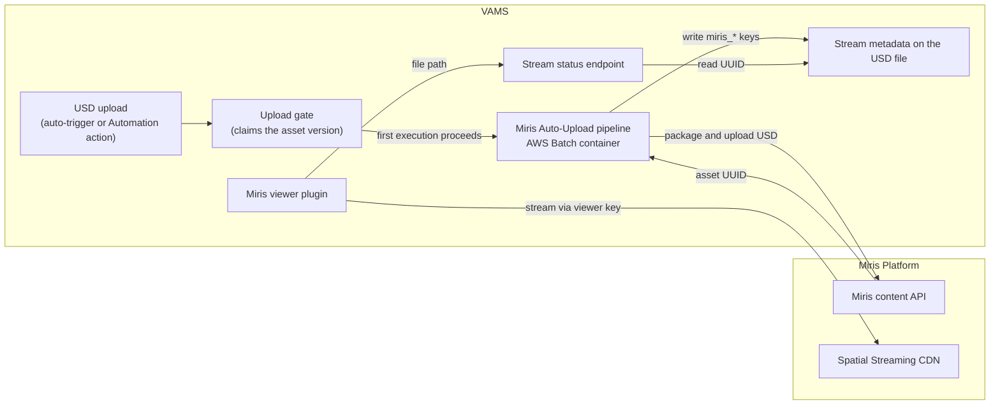

# Miris Spatial Streaming Integration

[Miris Spatial Streaming](https://miris.com) is a platform that delivers 3D geometry progressively — assets load at a lower fidelity first and sharpen to full quality within seconds, similar to video streaming but for 3D content. VAMS integrates with Miris so that USD assets can be uploaded to the Miris platform and then streamed directly inside the VAMS web viewer, without downloading the full geometry to the browser.

---

## How VAMS Integrates with Miris

The integration has two halves that work together:

-   **The Miris viewer plugin** renders Miris-hosted assets in the VAMS file viewer. When a user opens a USD file, the viewer streams the Miris asset recorded in that file's [stream metadata](#stream-metadata).
-   **The Miris Auto-Upload pipeline** uploads supported USD source assets to Miris, waits for processing, and records the resulting Miris asset as file metadata on the source USD file. See the [Miris Auto-Upload Pipeline](../../pipelines/miris-upload.md) for the pipeline details.

The end-to-end flow is: a USD asset is uploaded to Miris (automatically on file upload, or on demand through the file manager's **Automation** action) → Miris processes it into a streamable asset → the Miris asset UUID is written to the USD file's metadata → the viewer streams the asset when a user opens the USD file. The stream metadata can also be set by hand, for example to point a USD file at an asset that is already on Miris.

:::info
Miris integration is optional and does not affect core VAMS functionality. It cannot be enabled in GovCloud or air-gapped deployments, and it requires the `unsafe-eval` Content Security Policy directive (see [Requirements](#requirements-and-limitations)).
:::

---

## Viewer plugin

VAMS includes one Miris viewer plugin for USD files.

| Plugin ID             | Extensions                        | Priority | Feature flag      | Role                                                                |
| --------------------- | --------------------------------- | -------- | ----------------- | ------------------------------------------------------------------- |
| `miris-stream-viewer` | `.usd`, `.usda`, `.usdc`, `.usdz` | 0        | `MIRIS_STREAMING` | Streams the Miris asset recorded in the USD file's stream metadata. |

Because it has priority `0`, the plugin is auto-selected over other USD viewers (such as the Needle USD Viewer) when `MIRIS_STREAMING` is enabled; the viewer selector remains available to switch viewers. When a USD file is opened, the plugin calls the [stream status endpoint](../../api/miris.md) with the file's object key and acts on the result:

-   **The file has no Miris asset UUID**: shows a "Not yet streamed with Miris" note pointing to the file manager's **Automation** action, which runs the **Stream with Miris** template of the auto-registered `miris-upload` workflow on the file. The viewer does not start an upload itself.
-   **Miris is still preparing the asset**: shows a "preparing" overlay (processing typically takes 1–2 hours after upload) and refreshes automatically when the asset becomes streamable.
-   **The asset is streamable, or Miris could not be queried**: streams the asset using the deployment's viewer key, with `miris_display_name` as the overlay label. The status check is advisory and does not block streaming.
-   **The stored UUID is not a valid UUID, or Miris reports a processing failure**: shows an error message instead of the stream.

When the file records the Amazon S3 version it was streamed from (`miris_source_version_id`) and that version differs from the version being viewed, the viewer streams the recorded asset and shows a banner: "This stream was built from a different version of this file. Run Stream with Miris again to update it." When neither a file version nor an asset version is selected, the viewer compares against the file's current version; viewing a historical asset version without a file version shows no banner. A file without a recorded source version, which is typical of hand-edited metadata, shows no banner.

When a historical asset version is viewed, the viewer streams the Miris asset recorded in the file's current metadata, not in the version's metadata snapshot (see the [Miris API Reference](../../api/miris.md)).

The viewer reads the UUID through the status endpoint, never by downloading files, so streaming works for assets marked non-distributable. Per-asset access authorization still applies, and viewing a stream does not require access to the file metadata routes.

---

## Stream metadata

The Miris stream for a USD file is described by four keys in that file's metadata:

| Key                       | Type     | Meaning                                                                                                                                   |
| ------------------------- | -------- | ----------------------------------------------------------------------------------------------------------------------------------------- |
| `miris_asset_uuid`        | `string` | Miris asset to stream. The only key the viewer requires; a missing or empty value means the file is not streamed.                         |
| `miris_source_version_id` | `string` | Amazon S3 version ID of the USD file the stream was made from. Empty when the bucket is unversioned. Drives the different-version banner. |
| `miris_uploaded_at`       | `date`   | When the Miris upload completed (ISO 8601 UTC, for example `2026-10-14T09:30:00Z`).                                                       |
| `miris_display_name`      | `string` | Label shown over the stream in the viewer. The upload pipeline sets it to the name of the Miris asset.                                    |

The [upload pipeline](../../pipelines/miris-upload.md#what-the-pipeline-writes) writes all four keys on the USD file it ran for (the root layer of a multi-file USD). The keys do not begin with `VAMS_` or `_`, so they are indexed for search like any other metadata.

### Miris stream metadata schema

When `app.miris.enabled` is `true`, deployment seeds a GLOBAL `fileMetadata` schema named **Miris stream** (ID `miris-stream-file-schema`). It defines the four keys as optional fields with the types above and applies to files with the extensions `.usd`, `.usda`, `.usdc`, and `.usdz`. The fields appear in the file metadata editor for every USD file, whether or not the file has been streamed.

The schema record is written by a deployment custom resource:

-   It is written again on every deployment, so edits made to the **Miris stream** schema in the web interface, including disabling it, are undone by the next deployment.
-   It is not removed when Miris is disabled or when the stack is deleted. Delete it from the metadata schema page if it is no longer wanted.
-   In a database with `restrictMetadataOutsideSchemas: true`, the schema becomes an applicable schema for USD files, so enabling Miris prevents regular users from adding other keys that no schema defines to USD files in that database. Files with other extensions are unaffected. Pipeline writes made as `SYSTEM_USER` are not validated against schemas.
-   A file with no extension receives extension-restricted file schemas, so the **Miris stream** fields can also appear on such files.

### Editing the stream metadata

The keys are ordinary file metadata, and users can edit them through the **Miris stream** fields in the file metadata editor, the API, or the CLI. To stream a USD file from an asset that is already on Miris, set `miris_asset_uuid` on the file to that asset's UUID; `miris_display_name` is optional, and leaving `miris_source_version_id` empty streams without the different-version banner. Clearing `miris_asset_uuid` returns the file to the "Not yet streamed" state.

-   **Who can change the keys.** Any user with `PUT` permission on the asset can change or clear the keys. The viewer has no separate lock on them.
-   **Moving, renaming, and deleting.** Moving or renaming the USD file carries its metadata, including the stream keys, to the new path. Deleting the file deletes its metadata. Neither operation changes the asset on Miris.
-   **Re-running the upload.** Running **Stream with Miris** again overwrites the keys with the new Miris asset. See the [upload pipeline](../../pipelines/miris-upload.md#what-the-pipeline-writes) for details.

### Finding streamed files

In deployments with Amazon OpenSearch Service, file metadata is indexed under the `MD_` field, so files that have a stream can be found by searching on `MD_.miris_asset_uuid`. See [Metadata in search](../../concepts/metadata-and-schemas.md#metadata-in-search). Deployments without OpenSearch do not provide metadata search.

---

## Configuration

Enable Miris by setting `app.miris.enabled` to `true` and providing a viewer key. To also enable the auto-upload pipeline, configure `app.miris.upload`.

```json
{
    "app": {
        "webUi": {
            "allowUnsafeEvalFeatures": true
        },
        "miris": {
            "enabled": true,
            "viewerKey": "your-miris-viewer-key",
            "upload": {
                "enabled": true,
                "autoRegisterWithVAMS": true,
                "autoRegisterAutoTriggerOnFileUpload": true,
                "triggerExtensions": ".usd,.usda,.usdc,.usdz",
                "apiKeySecretArn": "arn:aws:secretsmanager:REGION:ACCOUNT:secret:miris-integration-key-XXXX",
                "mirisApiBaseUrl": "https://api.miris.com",
                "taskTimeoutSeconds": 1800,
                "maxAssetSizeBytes": 5000000000
            }
        }
    }
}
```

| Field                             | Required   | Description                                                                                                                 |
| --------------------------------- | ---------- | --------------------------------------------------------------------------------------------------------------------------- |
| `miris.enabled`                   | Yes        | Enables the Miris integration, the viewer key in `/secure-config`, the stream status endpoint, and the Miris stream schema. |
| `miris.viewerKey`                 | Yes        | Miris viewer key used by the stream viewer for authentication. Treat as a secret; only shown once at creation in Miris.     |
| `miris.upload.enabled`            | For upload | Deploys the auto-upload pipeline (the `MIRIS_UPLOAD` feature).                                                              |
| `miris.upload.apiKeySecretArn`    | For upload | AWS Secrets Manager ARN holding the Miris Integration Key used by the upload pipeline.                                      |
| `miris.upload.triggerExtensions`  | For upload | Comma-separated extensions that auto-trigger the pipeline (default `.usd,.usda,.usdc,.usdz`).                               |
| `miris.upload.mirisApiBaseUrl`    | For upload | Miris content API base URL (default `https://api.miris.com`).                                                               |
| `miris.upload.taskTimeoutSeconds` | For upload | Maximum time the upload container waits for Miris processing.                                                               |
| `miris.upload.maxAssetSizeBytes`  | For upload | Maximum source asset size accepted for upload.                                                                              |
| `webUi.allowUnsafeEvalFeatures`   | Yes        | Must be `true`; the Miris SDK requires the `unsafe-eval` CSP directive.                                                     |

Database scope for the auto-trigger is a property of the workflow that owns it, not a pipeline-level setting. The upload pipeline auto-registers a GLOBAL workflow (`miris-upload`) whose `fileUpload` trigger fires for a matching USD upload in any database. To restrict auto-uploads to specific databases, disable the global trigger and register a database-scoped copy of the workflow for each database that should auto-trigger — VAMS resolves database scope natively when it matches an uploaded file against workflow triggers.

Enabling these options sets the corresponding feature flags, which the frontend reads from `/api/secure-config`:

| Feature flag      | Enabled by                                             | Effect                                                  |
| ----------------- | ------------------------------------------------------ | ------------------------------------------------------- |
| `MIRIS_STREAMING` | `app.miris.viewerKey` + `allowUnsafeEvalFeatures`      | Enables the `miris-stream-viewer` plugin for USD files. |
| `MIRIS_UPLOAD`    | `app.miris.upload.enabled` + `allowUnsafeEvalFeatures` | Indicates that the auto-upload pipeline is deployed.    |

For the complete configuration reference, see the [Configuration Reference](../../deployment/configuration-reference.md).

---

## Architecture



The upload pipeline packages a multi-file USD root into a single `.usdz` (using OpenUSD dependency resolution) before upload, since the Miris content API accepts one self-contained file per asset. The viewer plugin streams the prepared asset directly from the Miris platform using the deployment's viewer key; VAMS never proxies or stores the streamed geometry.

---

## Implementation notes

The viewer-plugin registry selects a plugin by **file extension** alone, but whether a USD file has a Miris stream is **per-file runtime data**. The `miris-stream-viewer` plugin therefore asks the stream status endpoint at render time; the endpoint reads the `miris_*` keys of exactly the requested file server side, so the browser never supplies a UUID of its own and a caller can only learn the status of a stream the file itself references. The endpoint is deployed whenever `app.miris.enabled` is `true`, so hand-edited streams work in deployments without the upload pipeline.

The viewer is a read-only status surface; it never triggers the pipeline itself. Triggering an upload is a standard Workflows/Executions operation: run the auto-registered `miris-upload` workflow from the file manager's **Automation -> Execute Workflow** action (selecting the USD source file), or let the auto-registered `fileUpload` trigger fire automatically when `app.miris.upload.autoRegisterAutoTriggerOnFileUpload` is enabled.

Because a `fileUpload` trigger fires once per matching file, a multi-file USD asset made up of several standalone `.usd`/`.usda`/`.usdc` layers can fan out to one execution per layer. The gate Lambda (`mirisUploadGate`) collapses that fan-out to a single upload by claiming the asset's `(assetId, currentVersionId)` pair with a conditional S3 put — the first execution to reach the gate proceeds, and every other execution for the same asset version reports itself as skipped and exits as a no-op. See the [Miris Auto-Upload Pipeline](../../pipelines/miris-upload.md) for the pipeline-side detail.

---

## Requirements and limitations

-   `app.miris.enabled` must be `true`, with a valid `app.miris.viewerKey`.
-   `app.webUi.allowUnsafeEvalFeatures` must be `true` — the Miris SDK uses WebAssembly and requires the `unsafe-eval` CSP directive. Review this with your security team.
-   The upload pipeline requires a Miris Integration Key stored in AWS Secrets Manager, referenced by `app.miris.upload.apiKeySecretArn`.
-   Browser support: Chrome 90+, Firefox 88+, Safari 14+, Edge 90+, with WebGL 2.0 and WebSocket support. HTTPS is mandatory.
-   After upload, Miris processes an asset (typically 1–2 hours) before it is streamable.
-   Cannot be enabled in GovCloud or air-gapped deployments.

---

## Related resources

-   [Miris Auto-Upload Pipeline](../../pipelines/miris-upload.md): the upload pipeline that writes the stream metadata
-   [Miris API Reference](../../api/miris.md): the stream status endpoint
-   [File Viewers](../../concepts/viewers.md): master viewer table and extension mapping
-   [Viewer Plugins Reference](../../additional/viewer-plugins.md): viewer configuration fields
-   [Configuration Reference](../../deployment/configuration-reference.md): full `app.miris.*` configuration options
