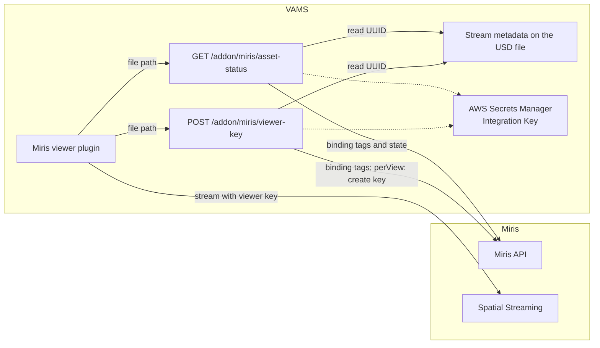

# Miris Spatial Streaming

[Miris](https://miris.com/) is a partner ISV whose Spatial Streaming service delivers 3D geometry progressively: an asset loads at a lower fidelity first and sharpens to full quality within seconds, much as a video stream does. VAMS integrates with Miris through an optional [add-on](addons-overview.md) that streams USD files from Miris inside the VAMS file viewer, without downloading the full geometry to the browser.

The add-on and the [Miris Upload pipeline](../pipelines/miris-upload.md) work together:

-   **The Miris Spatial Streaming add-on** (`app.addons.useMirisStreaming`) deploys the Miris viewer plugin for USD files, the two API routes it calls, the GLOBAL **Miris stream** file metadata schema, and the Content Security Policy sources the Miris web SDK needs. It holds the Miris Integration Key and API base URL that both parts use.
-   **The Miris Upload pipeline** (`app.pipelines.useMirisUpload`) uploads a VAMS asset's root USD file to Miris and records the resulting Miris asset as [stream metadata](#stream-metadata) on that file. It requires the add-on.

The end-to-end flow is: a USD asset is uploaded to Miris, automatically on file upload or on demand through the file manager's **Automation** action; Miris processes it into a streamable asset; the Miris asset UUID is written to the metadata of the asset's root USD file; and the viewer streams the asset when a user opens that file. The stream metadata can also be set by hand, for example to point a USD file at an asset that is already on Miris.

:::info
The add-on is off by default and does not affect other VAMS functionality when disabled. Miris is a service on the public internet, so the add-on deploys only to the commercial `aws` partition, and it requires `app.webUi.allowUnsafeEvalFeatures` (see [Requirements and limitations](#requirements-and-limitations)).
:::

---

## How the add-on works

The viewer plugin selects by file extension, but whether a USD file has a Miris stream is per-file data. The viewer therefore asks VAMS at render time. Both API routes read the `miris_*` keys of exactly the requested file server side, so the browser never supplies a Miris asset UUID of its own and a caller can reach only a stream that the file itself references.



1. **Stream status.** The viewer calls `GET /addon/miris/asset-status` with the file's path. VAMS authorizes the caller, reads the file's stream metadata, reads the Miris asset with the Integration Key to check its [binding tags](#binding-tags), and reports the stream's state.
2. **Viewer key.** When the state allows streaming, the viewer calls `POST /addon/miris/viewer-key`. VAMS repeats the authorization and the binding check, then returns a viewer key: the deployment-wide key in `static` mode, or a key minted for this one Miris asset in `perView` mode. The viewer holds the key in memory for that open only.
3. **Streaming.** The viewer loads the Miris web SDK and streams the asset directly from Miris. VAMS never proxies or stores the streamed geometry.

Both routes enforce the VAMS two-tier authorization: Tier 1 on the route, and Tier 2 `GET` on the asset named by `databaseId` and `assetId` before any metadata is read. A viewer key grants streaming only, so the viewer key route checks a read of the asset even though it is a `POST`. See the [Add-on API reference](../api/addon.md#miris-spatial-streaming-add-on) for the request and response shapes.

### Binding tags

A Miris asset is bound to a VAMS asset by two tags on the Miris asset: `vams-asset-{assetId}` and `vams-database-{databaseId}`. Both are required, because an asset ID is unique only within its database. In both viewer key modes, the status and viewer key routes read the Miris asset with the Integration Key and accept it only when it carries both tags of the VAMS asset being viewed.

A Miris asset that lacks either tag, or that Miris reports as missing (`404`), is `notBound`: the status route reports that state, the viewer key route returns `403` with `state: notBound` and returns no key, and the viewer shows an error that names both tags. Miris reports an asset as missing when it was deleted or when it is not visible to the Integration Key's workspace.

Miris assets that the upload pipeline creates always carry both tags, and the pipeline drops any template tag that uses either prefix. A Miris asset linked by hand, by setting `miris_asset_uuid` on a file, needs both tags added: in the Miris Portal, edit the asset's tags and add `vams-asset-<assetId>` and `vams-database-<databaseId>`, or use the Miris CLI's `miris asset update` command with its `--add-tags` option.

---

## Viewer plugin

The add-on includes one viewer plugin for USD files.

| Plugin ID             | Extensions                        | Priority | Feature flags                       | Role                                                                |
| --------------------- | --------------------------------- | -------- | ----------------------------------- | ------------------------------------------------------------------- |
| `miris-stream-viewer` | `.usd`, `.usda`, `.usdc`, `.usdz` | 0        | `MIRIS_ADDON` and `ALLOWUNSAFEEVAL` | Streams the Miris asset recorded in the USD file's stream metadata. |

The plugin's entry in `web/src/visualizerPlugin/config/addonViewerConfig.json` sets `autoSelect: true`. When the plugin is the only USD viewer at the lowest priority (`0`), it opens automatically in visualize mode instead of waiting for the user to choose; the Needle USD Viewer (priority `1`) stays in the viewer selector. In compare mode the viewer selector behaves as for any other file type.

When a USD file is opened, the plugin acts on the stream status:

| Status `state`                    | What the viewer shows                                                                                                                                                                                                                                                                                                                                                                                                      |
| --------------------------------- | -------------------------------------------------------------------------------------------------------------------------------------------------------------------------------------------------------------------------------------------------------------------------------------------------------------------------------------------------------------------------------------------------------------------------- |
| `notStreamed`                     | A "Not yet streamed with Miris" note. It suggests the Needle USD Viewer for viewing the file now, and the file manager's **Automation** action, which runs the **Stream with Miris** template, for streaming it. The viewer starts no upload.                                                                                                                                                                              |
| `processing`, `preview`, or other | A "Miris is preparing this asset" overlay with the current state. Processing typically takes 1–2 hours. The viewer checks the status again every 90 seconds and, once the state leaves this group, loads the file again from the status check.                                                                                                                                                                             |
| `streamable` or `unknown`         | Requests a viewer key and streams the asset, with `miris_display_name` as the overlay label. The status check is advisory: `unknown` means the state could not be established, and the viewer still attempts the stream. In `static` mode, a deployment viewer key whose Miris tag scope does not cover the asset makes the Miris viewer API answer `404`, which is also reported as `unknown`; the stream then times out. |
| `notBound`                        | An error that names both [binding tags](#binding-tags).                                                                                                                                                                                                                                                                                                                                                                    |
| `invalidUuid`                     | An error stating that `miris_asset_uuid` is not a valid UUID.                                                                                                                                                                                                                                                                                                                                                              |
| `error` or `failed`               | An error stating that Miris processing failed.                                                                                                                                                                                                                                                                                                                                                                             |

Each error message offers a **Retry** button that loads the stream again, starting with the status check. A viewer key request that fails shows its own error: `403` without `notBound` as a permission error, `503` as "Miris streaming is not configured for this deployment", and any other failure as an access error, except `404`, which shows the "Not yet streamed with Miris" note. A request that the deployment's AWS WAF web ACL blocks shows the blocking message instead of a permission error.

When the file records the Amazon S3 version it was streamed from (`miris_source_version_id`) and that version differs from the version being viewed, the viewer streams the recorded asset and shows a banner: "This stream was built from a different version of this file. Run Stream with Miris again to update it." When neither a file version nor an asset version is selected, the viewer compares against the file's current version; viewing a historical asset version without a file version shows no banner. A file without a recorded source version, which is typical of hand-edited metadata, shows no banner.

The routes read the stream metadata of the file's current record, so viewing a historical asset version streams the Miris asset recorded in the file's current metadata, not in the version's metadata snapshot. The viewer never downloads the file, so streaming works for assets marked non-distributable. Per-asset authorization still applies, and viewing a stream does not require access to the file metadata routes.

### Web SDK

The viewer renders with the Miris web SDK, which VAMS bundles from three npm packages: `@miris-inc/components` (the `<miris-scene>`, `<miris-camera>`, and `<miris-stream>` elements the viewer renders), `@miris-inc/three`, and `@miris-inc/core`. All three are pinned to the same exact version in `web/package.json`, because the packages publish in lockstep and pin one another exactly; change their versions together. The web application's `three` dependency is the one the SDK renders with.

The viewer loads the SDK only after it has a viewer key, so a file that is not streamed never loads it. The SDK renders with WebGPU where the browser grants a WebGPU adapter; otherwise the viewer selects the SDK's WebGL 2 engine before the first scene mounts. A device with neither shows "Miris streaming is not supported on this device" instead of a blank panel. Miris assets in the GES format need WebGPU; on a browser without a WebGPU adapter the SDK shows its own message for those assets.

The viewer waits 60 seconds for the SDK to load and 60 seconds for the first frame of a stream before it shows an error.

### Content Security Policy

With the add-on enabled, the Content Security Policy gains `https://*.miris.com` and `wss://*.miris.com` in `connect-src`, and `blob:` in `script-src`, because the SDK loads part of its engine from a `blob:` script. The SDK also needs `'unsafe-eval'`, which only `app.webUi.allowUnsafeEvalFeatures` adds, and `'wasm-unsafe-eval'`, which the base policy carries. The Miris API base URL is called only by the add-on's Lambda functions and is not a browser source. With the add-on disabled the policy carries none of these sources. See [Security Architecture](../architecture/security.md#conditional-csp-sources).

---

## Viewer key modes

`app.addons.useMirisStreaming.viewerKeyMode` selects how the viewer key route delivers keys. Both modes read the Integration Key, which the binding check needs.

| Mode               | What `POST /addon/miris/viewer-key` returns                                                                                                                             | `expiresAt` |
| ------------------ | ----------------------------------------------------------------------------------------------------------------------------------------------------------------------- | ----------- |
| `static` (default) | The deployment-wide `viewerKey`, after the authorization and binding checks. No key is created and nothing is stored.                                                   | `null`      |
| `perView`          | A key created with the Integration Key for the file's one Miris asset (no tags, the one asset ID), which expires `viewerKeyTtlMinutes` after it is minted (default 15). | The expiry  |

### Static mode

The deployment's viewer key is set as an environment variable of the status and viewer key Lambda functions only; it is not part of `/api/secure-config`. A user receives it only from the viewer key route, after both authorization tiers and the binding check pass for an asset the user can read.

:::warning[The static key is deployment-wide]
Anyone who can read one bound asset receives the deployment's viewer key, and that key streams every Miris asset it allows, not only the asset that was opened. Scope the static key in Miris with tags and give it an expiry, or use `perView` mode where access to a stream must follow VAMS permissions asset by asset. Miris shows a viewer key only once, at creation.
:::

### Per-view mode

In `perView` mode, no shared viewer key is deployed. Each viewer open mints a key that can start streams of one Miris asset for at most `viewerKeyTtlMinutes` (1 to 60, default 15), and records it in the add-on's viewer key table under its Miris key ID, with a `ttl` one hour after the key's expiry. When DynamoDB TTL removes the row, the cleanup Lambda function deletes the key from the Miris workspace. TTL deletion is lazy, so an expired key can remain in the workspace for some time after its row's `ttl`; it can no longer start a stream. A cleanup batch that still fails after its retries is recorded in a dead-letter queue.

-   A key is minted only for a user who can read the VAMS asset, and only for a Miris asset that carries that asset's [binding tags](#binding-tags).
-   When a minted key cannot be recorded, VAMS attempts to delete the key from Miris, and the request fails with `500`.
-   Users can mint keys at their API request rate, which API Gateway throttling limits.

Viewer key expiry and revocation are enforced by Miris when a stream starts; a stream that is already open is not ended. In both modes the viewer key is visible in the browser, because the viewer sets it on the `<miris-scene>` element; a short lifetime limits the exposure of a copied key.

### Audit records

Each key delivery is written to the `AUTHOTHER` audit log. Neither record holds the key material.

| Type                        | Mode      | Fields                                                                                           |
| --------------------------- | --------- | ------------------------------------------------------------------------------------------------ |
| `mirisStaticViewerKeyIssue` | `static`  | `userId`, `databaseId`, `assetId`, `filePath`, `mirisAssetUuid`                                  |
| `mirisViewerKeyMint`        | `perView` | `userId`, `databaseId`, `assetId`, `filePath`, `mirisAssetUuid`, `mirisViewerKeyId`, `expiresAt` |

See [Audit Logging](audit-logging.md) for the audit log groups.

### Switching modes

-   **To `perView`**: set `viewerKeyMode` to `"perView"`, remove `viewerKey`, and deploy. Then revoke the old static viewer key in the Miris Portal or with `miris viewerkey revoke`, because a browser that received it can still stream with it until it expires.
-   **Back to `static`**: set `viewerKeyMode` to `"static"` and `viewerKey`, and deploy. The cleanup function and its queue are removed, while the viewer key table is retained, as every VAMS table is. Keys minted before the switch stay in the Miris workspace until they are deleted there; they have already expired or expire within `viewerKeyTtlMinutes`.

---

## Stream metadata

The Miris stream for a USD file is described by four keys in that file's metadata:

| Key                       | Type     | Meaning                                                                                                                                   |
| ------------------------- | -------- | ----------------------------------------------------------------------------------------------------------------------------------------- |
| `miris_asset_uuid`        | `string` | Miris asset to stream. The only key the viewer requires; a missing or empty value means the file is not streamed.                         |
| `miris_source_version_id` | `string` | Amazon S3 version ID of the USD file the stream was made from. Empty when the bucket is unversioned. Drives the different-version banner. |
| `miris_uploaded_at`       | `date`   | When the Miris upload completed (ISO 8601 UTC, for example `2026-10-14T09:30:00Z`).                                                       |
| `miris_display_name`      | `string` | Label shown over the stream in the viewer. The upload pipeline sets it to the name of the Miris asset.                                    |

The [upload pipeline](../pipelines/miris-upload.md#what-the-pipeline-writes) writes all four keys on the asset's root USD file. The keys do not begin with `VAMS_` or `_`, so they are indexed for search like any other metadata: in deployments with Amazon OpenSearch Service, files that have a stream can be found by searching on `MD_.miris_asset_uuid` (see [Metadata in search](../concepts/metadata-and-schemas.md#metadata-in-search)).

### Miris stream metadata schema

When the add-on is enabled, deployment seeds a GLOBAL `fileMetadata` schema named **Miris stream** (ID `miris-stream-file-schema`). It defines the four keys as optional fields with the types above and applies to files with the extensions `.usd`, `.usda`, `.usdc`, and `.usdz`. The fields appear in the file metadata editor for every USD file, whether or not the file has been streamed.

-   The schema record is written by a deployment custom resource on every deployment, so edits made to the **Miris stream** schema in the web interface, including disabling it, are undone by the next deployment.
-   It is not removed when the add-on is disabled or when the stack is deleted. Delete it from the metadata schema page if it is no longer wanted.
-   In a database that restricts metadata to schema-defined fields (see [Schema enforcement](../concepts/metadata-and-schemas.md#schema-enforcement)), the schema is an applicable schema for USD files, so enabling the add-on prevents users from adding keys that no schema defines to USD files in that database. Files with other extensions are unaffected.

### Editing the stream metadata

The keys are ordinary file metadata, and users with `PUT` permission on the asset can edit them through the **Miris stream** fields in the file metadata editor, the API, or the CLI. To stream a USD file from an asset that is already on Miris, set `miris_asset_uuid` on the file to that asset's UUID and add the [binding tags](#binding-tags) to the Miris asset; `miris_display_name` is optional, and leaving `miris_source_version_id` empty streams without the different-version banner. Clearing `miris_asset_uuid` returns the file to the "Not yet streamed" state.

Moving or renaming the USD file carries its metadata, including the stream keys, to the new path. Deleting the file deletes its metadata. Neither operation changes the asset on Miris. Running **Stream with Miris** again overwrites the keys with a new Miris asset; see [What the pipeline writes](../pipelines/miris-upload.md#what-the-pipeline-writes).

---

## Configuration

Enable the add-on by setting `app.addons.useMirisStreaming.enabled` to `true`, with `app.webUi.allowUnsafeEvalFeatures` set to `true`, the ARN of the secret that holds the Miris Integration Key, and either a viewer key (`static` mode) or `viewerKeyMode: "perView"`.

```json
{
    "app": {
        "webUi": {
            "allowUnsafeEvalFeatures": true
        },
        "addons": {
            "useMirisStreaming": {
                "enabled": true,
                "viewerKeyMode": "static",
                "viewerKey": "your-miris-viewer-key",
                "viewerKeyTtlMinutes": 15,
                "apiKeySecretArn": "arn:aws:secretsmanager:us-east-1:111122223333:secret:miris-integration-key-AbCdEf",
                "mirisApiBaseUrl": "https://app.miris.com"
            }
        }
    }
}
```

| Field                 | Required         | Description                                                                                                                                                                                                                  |
| --------------------- | ---------------- | ---------------------------------------------------------------------------------------------------------------------------------------------------------------------------------------------------------------------------- |
| `enabled`             | Yes              | Deploys the add-on: the two API routes, the viewer plugin (`MIRIS_ADDON` feature switch), the **Miris stream** schema, and its Content Security Policy sources.                                                              |
| `viewerKeyMode`       | No               | `"static"` (default) returns `viewerKey`. `"perView"` mints a short-lived viewer key for each viewer open.                                                                                                                   |
| `viewerKey`           | In `static` mode | The Miris viewer key the viewer streams with. At least 16 characters, with no leading or trailing whitespace. Generate one in the Miris Portal or with `miris viewerkey create`. Ignored, with a warning, in `perView` mode. |
| `viewerKeyTtlMinutes` | No               | Lifetime of a per-view viewer key, in whole minutes from 1 to 60 (default 15).                                                                                                                                               |
| `apiKeySecretArn`     | Yes              | The complete ARN of the AWS Secrets Manager secret that holds the Miris Integration Key as a plain string, including the six-character suffix Secrets Manager appends to the secret name. Required in both modes.            |
| `mirisApiBaseUrl`     | No               | Miris API base URL (default `https://app.miris.com`). Must be an `https` URL that names an external host, with no surrounding whitespace.                                                                                    |

Enabling the add-on sets the `MIRIS_ADDON` feature switch, which the web interface reads from `/api/secure-config`. The viewer plugin requires both `MIRIS_ADDON` and `ALLOWUNSAFEEVAL`. For every validation rule, see the [Configuration Reference](../deployment/configuration-reference.md#miris-spatial-streaming-appaddonsusemirisstreaming).

### Integration Key

The Integration Key authenticates the add-on's Lambda functions to the Miris API: the status and viewer key functions read Miris assets and their tags with it, the viewer key function mints per-view keys with it, and the cleanup function deletes expired keys with it. The upload pipeline uses the same secret. An Integration Key carries the permissions of the person who created it and resolves to that person's default Miris workspace, which must be the workspace that holds the streamed assets.

-   Create the key for a Miris service account that is a member of only the workspace VAMS uses, so a change to a person's default workspace cannot move the key to another one.
-   Store it in AWS Secrets Manager as a plain-string secret in the deployment's account. VAMS grants `secretsmanager:GetSecretValue` on exactly that ARN and no AWS KMS permission for it, so a secret encrypted with a customer managed key other than the VAMS key needs a key policy that lets the reading roles call `kms:Decrypt`.
-   The functions cache the key for up to an hour per execution environment, and drop the cached key and read it again when Miris answers `401` or `403`.

### Miris API calls

The add-on's Lambda functions never follow a redirect from Miris, so the Integration Key is never sent to another host. A `mirisApiBaseUrl` that redirects makes every call fail: the status route reports `unknown` and the viewer key route answers `502`.

Each API request has a best-effort deadline for its Miris calls: 20 seconds from when the handler sets it, shortened so that it falls 3 seconds before API Gateway's 29-second integration timeout, counted from the time API Gateway received the request, and 3 seconds before the Lambda function's own remaining time. A call is not started with less than 1 second left, and each call's connect and read timeouts (5 and 15 seconds) are scaled down to fit the time that remains. A response that keeps sending data can still outlast the deadline. When the deadline passes, the status route reports `unknown` and the viewer key route answers `504`.

### Permissions

The status route needs Tier 1 `GET` on `/addon/miris/asset-status` and the viewer key route needs Tier 1 `POST` on `/addon/miris/viewer-key`. Both need Tier 2 `GET` on the asset, so a user can stream only assets they can view.

-   The Database Admin, Database User, Database Read-Only, and Global Read-Only permission templates grant both routes with `equals` criteria. On a deployment without the add-on the criteria match no route.
-   The seeded `basicReadOnly` role gains both routes when the add-on is enabled.
-   A custom role needs constraints that allow `GET` on the status route and `POST` on the viewer key route. A role imported from an earlier copy of a template does not carry them until the template is imported again or the constraints are added.

See [Permissions Model](../concepts/permissions-model.md#add-on-routes) for the Tier 2 fields.

---

## AWS resources

The add-on deploys a nested stack, `infra/lib/nestedStacks/addon/miris/mirisBuilder-nestedStack.ts` (`MirisBuilderNestedStack`), inside the add-on builder stack:

| Resource                                     | Created when   | Purpose                                                                                                      |
| -------------------------------------------- | -------------- | ------------------------------------------------------------------------------------------------------------ |
| `MirisGetAssetStatusFunction` Lambda         | Always         | Serves `GET /addon/miris/asset-status`                                                                       |
| `MirisMintViewerKeyFunction` Lambda          | Always         | Serves `POST /addon/miris/viewer-key`                                                                        |
| Miris stream schema custom resource and role | Always         | Writes the **Miris stream** schema to the metadata schema table; the role can only put items into that table |
| `MirisViewerKeyStorageTable` DynamoDB table  | `perView` mode | Records each per-view key ID; `KEYS_ONLY` stream; `RETAIN`, auto-named                                       |
| `addon/miris/viewerKeyStorage` SSM parameter | `perView` mode | Publishes the table name under the deployment's resource-name prefix                                         |
| `MirisViewerKeyCleanupFunction` Lambda       | `perView` mode | Deletes a key from Miris when TTL removes its row                                                            |
| `MirisViewerKeyCleanupDLQ` Amazon SQS queue  | `perView` mode | On-failure destination of the cleanup stream mapping (14-day retention)                                      |

See [AWS Resources](../architecture/aws-resources.md) for removal policies and naming.

---

## Requirements and limitations

-   **Commercial partition only.** Configuration validation rejects the add-on in any partition other than `aws`, which excludes AWS GovCloud (US) and the AWS European Sovereign Cloud. Every browser that streams, and the add-on's Lambda functions, must reach `*.miris.com`.
-   **`app.webUi.allowUnsafeEvalFeatures` must be `true`.** The Miris web SDK compiles code at runtime. Review this with your security team.
-   **Lambda functions in the VPC have no route to Miris.** With `app.useGlobalVpc.useForAllLambdas` set to `true`, the add-on's Lambda functions run in the isolated subnets, which have no internet egress, so every Miris API call fails. See [Network Architecture](../architecture/networking.md).
-   **Browser support.** Chrome 90+, Firefox 88+, Safari 14+, or Edge 90+, with WebSocket support and either WebGPU or WebGL 2.0. GES assets need WebGPU. HTTPS is required.
-   **Processing time.** After upload, Miris processes an asset, typically for 1–2 hours, before it is streamable.

---

## Troubleshooting

-   **The viewer shows "Not yet streamed with Miris"**: the file has no `miris_asset_uuid`. Run **Stream with Miris** on the asset, or set the stream metadata by hand.
-   **"The Miris asset recorded for this file is not linked to this VAMS asset"**: add the two [binding tags](#binding-tags) to the Miris asset, or run **Stream with Miris** on the file again. The error also appears when Miris reports that it has no such asset: it was deleted, or it is not visible to the Integration Key's workspace.
-   **The viewer shows "Miris streaming is not configured for this deployment"**: the viewer key route answered `503` because a setting its mode needs is missing from the function environment. Check the add-on configuration and redeploy.
-   **The panel shows "Miris streaming is not supported on this device"**: the browser grants neither a WebGPU adapter nor a WebGL 2 context. Enable hardware acceleration, or use a supported browser.
-   **"The Miris viewer failed to load"**: the SDK did not load within 60 seconds. Check the browser's network panel for blocked or stalled SDK and `.wasm` requests and the console for Content Security Policy violations.
-   **"Timed out waiting for Miris to start streaming"**: no first frame arrived within 60 seconds. An invalid or expired viewer key, a key from another Miris workspace, a `static` mode viewer key whose Miris tag scope does not cover the asset, and a blocked `*.miris.com` connection also surface this way.
-   **The "Miris is preparing this asset" overlay never clears**: the asset stays at `preview`. Promotion to `streamable` is a separate Miris processing step that requires the Miris entitlement for it; without that entitlement the asset remains at `preview`. Check the asset in the Miris Portal, where it can also be promoted by hand.
-   **The status stays `unknown`**: the status function could not reach Miris or read the Integration Key, Miris answered with a redirect, or, in `static` mode, the deployment viewer key's Miris tag scope does not cover the asset (the viewer API answers `404`). Check the `MirisGetAssetStatusFunction` logs, the secret ARN, `mirisApiBaseUrl`, the viewer key's tag scope, and the function's network path to `*.miris.com`.

---

## Related resources

-   [Miris Upload pipeline](../pipelines/miris-upload.md): the pipeline that writes the stream metadata
-   [Add-on API reference](../api/addon.md#miris-spatial-streaming-add-on): the stream status and viewer key routes
-   [File Viewers](../concepts/viewers.md#add-on-viewers): the master viewer table and extension mapping
-   [Configuration Reference](../deployment/configuration-reference.md#miris-spatial-streaming-appaddonsusemirisstreaming): every `app.addons.useMirisStreaming` field and rule
