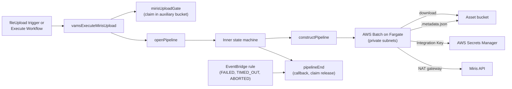

# Miris Upload

The Miris Upload pipeline uploads a VAMS asset's root USD file to [Miris](https://miris.com/) Spatial Streaming, waits for Miris to accept it, and records the resulting Miris asset as [stream metadata](../developer/miris-spatial-streaming.md#stream-metadata) on that file. Once the metadata is written, users can stream the asset from the VAMS file viewer by opening the file.

The pipeline works with the [Miris Spatial Streaming add-on](../developer/miris-spatial-streaming.md), which provides the viewer that streams the uploaded asset and holds the Miris Integration Key and API base URL the pipeline uses. `app.pipelines.useMirisUpload` requires `app.addons.useMirisStreaming`.

| Property           | Value                                                                                                 |
| ------------------ | ----------------------------------------------------------------------------------------------------- |
| **Pipeline ID**    | `miris-upload`                                                                                        |
| **Configuration**  | `app.pipelines.useMirisUpload`                                                                        |
| **Execution type** | Lambda (asynchronous, with callback)                                                                  |
| **Compute**        | AWS Batch on AWS Fargate (1 vCPU, 2 GiB memory, 21 GiB ephemeral storage, x86_64), in private subnets |
| **Input formats**  | `.usd`, `.usda`, `.usdc`, `.usdz`                                                                     |
| **Output**         | File metadata on the asset's root USD file; no new files                                              |
| **VPC required**   | Yes, with internet egress through a NAT gateway to `*.miris.com`                                      |
| **Partition**      | Commercial `aws` only                                                                                 |
| **Region**         | Same-Region only: input and output buckets must be in the deployment Region                           |

---

## How a run starts

The pipeline auto-registers as a GLOBAL pipeline and workflow, both with the ID `miris-upload`, and the workflow carries a `fileUpload` trigger and the **Stream with Miris** template. It runs in two ways:

-   **Automatically.** When `app.pipelines.useMirisUpload.autoRegisterAutoTriggerOnFileUpload` is `true`, the trigger fires for every uploaded file with a `.usd`, `.usda`, `.usdc`, or `.usdz` extension in any database. To restrict uploads to specific databases, disable the global trigger and register a database-scoped copy of the workflow for each database that should upload.
-   **On demand.** Select one of the asset's USD files in the file manager, choose **Automation**, then **Execute Workflow**, and pick the **Miris Spatial Streaming Upload** workflow with its **Stream with Miris** template.

Either way, the workflow takes exactly one file. A whole-asset (`/`) or folder selection is rejected in the execute wizard. The file only names the asset: the pipeline uploads the asset's [root USD file](#how-the-root-is-chosen), whichever of its USD files started the run, and records the stream metadata on that root file.

### Duplicate uploads and re-runs

A `fileUpload` trigger fires once per matching file, so an asset made of several USD layers fans out to one execution per layer. The pipeline's gate Lambda function collapses that fan-out with a claim, written as a conditional Amazon S3 put (`If-None-Match: *`) in the auxiliary bucket:

```text
s3://<auxiliary-bucket>/locks/miris-upload/<assetId>/<fingerprint>.claim
```

The fingerprint is a SHA-256 digest of the asset-relative key and ETag of every file under the asset's root whose extension is one of `triggerExtensions`. Executions fanned out from one upload compute the same fingerprint once all of its USD files are in place, so the first to write the claim proceeds and the others report themselves as skipped and exit without an AWS Batch job.

-   **Unchanged USD files.** A successful upload keeps its claim, so a later trigger on the same USD content is skipped.
-   **Changed, added, or reverted USD files.** Any change to a USD layer's key or content gives a new fingerprint, so the next trigger uploads again. A successful upload also deletes the asset's claims on other content, so returning to earlier content uploads again.
-   **Failed runs.** A run that does not succeed releases its claim, so the next trigger on the same content uploads.
-   **Manual runs.** A run of the **Miris Spatial Streaming Upload** workflow from **Execute Workflow** always uploads and writes no claim. When it succeeds it deletes the asset's existing claims, so the next trigger uploads again. No claim object needs to be deleted by hand.

### Known limitations

-   **A change to non-USD files does not start an upload.** Only files with a trigger extension enter the fingerprint, so a change to textures or other files that leaves every USD file unchanged gives the same fingerprint and the trigger is skipped. Run the **Miris Spatial Streaming Upload** workflow on one of the asset's USD files to upload the change.
-   **A queued run uploads the asset as it is when its job starts.** The container lists and downloads the asset when its AWS Batch job starts, not when the gate fingerprinted it. When newer files land while a run waits in the job queue, that run can upload the newer content under the earlier claim. The next trigger corrects the stream; so does running the **Miris Spatial Streaming Upload** workflow.
-   **A multi-file upload can upload twice.** Each uploaded file starts its own execution. A gate that runs before every USD file of the upload has landed computes a different fingerprint from the later ones, so that run uploads as well.

---

## How the root is chosen

The root is the one file, among the asset's files with a trigger extension, that no other USD layer in the asset references through a sublayer, reference, payload, value clip, or asset-valued attribute. An asset with a single `.usdz` and no other USD layer uses that `.usdz`.

-   More than one candidate root fails the run with `ambiguous_root` (exit code 10), and the container log lists the candidates. Keep one root layer per asset, or reference the other layers from it.
-   A USD layer that cannot be read, because it is empty or malformed, fails the run with `unreadable_layer` (exit code 11), and the container log names the file.
-   An asset whose USD files all reference one another has no root and fails with exit code 6.

### Multi-file USD assets

The Miris content API accepts one self-contained file per asset. A root `.usd`, `.usda`, or `.usdc` that references external files, such as textures and sublayers, is packaged into a single `.usdz` inside the container before upload. Dependency discovery uses OpenUSD's `UsdUtils.ComputeAllDependencies`, so only referenced files are included. A root with no external references is uploaded as is, and a `.usdz` root is passed through unchanged.

**References must be relative.** A reference to an absolute path, such as `/Users/designer/textures/wood.png`, cannot be resolved inside the container, so the run fails with an `unresolved_references` log entry and exit code 5 instead of producing a broken asset. Re-export the asset with relative paths and upload it again.

---

## What the container does

The container lists the asset under its resolved root, which carries the bucket's `baseAssetsPrefix` or the asset's existing-key location, and chooses the root USD file. It checks `maxAssetSizeBytes` against the sizes in that listing before it downloads anything: a lone `.usdz` root counts alone, and otherwise every file under the asset root counts. It downloads what it needs, preserving the relative layout so USD references resolve, pins each candidate root to the Amazon S3 version it read, packages a multi-file root, and runs the Miris upload:

1. `POST /v1/content` starts the upload and returns a Miris asset ID and short-lived upload credentials.
2. A SigV4-signed `PUT` sends the file to the Miris upload storage, under the exact file name declared as the content path.
3. `PUT /v1/content/{id}` with `{"status": "completed"}` marks the upload complete.
4. `GET /v1/asset/{id}` is polled every 10 seconds until the asset's state is `preview` or `streamable`, for at most `taskTimeoutSeconds`. A state of `error` or `failed` fails the run.
5. `POST /v1/asset/{id}/generate` requests streamable processing. This step is best effort: when it fails, the asset can be promoted in the Miris Portal.
6. The stream metadata file for the root USD file is written to the run's metadata output path (see [What the pipeline writes](#what-the-pipeline-writes)).

The container retries its idempotent Miris calls (`GET`, `PUT`, and `DELETE`) with backoff after a transient request failure or a `429`, `500`, `502`, `503`, or `504` response, and never retries the request that creates the asset. When a step fails after the Miris asset exists, the container deletes that asset, best effort, and logs its ID. The container runs as a non-root user.

### Miris asset name and tags

The **Stream with Miris** template has two optional fields:

| Template field     | Effect                                                   |
| ------------------ | -------------------------------------------------------- |
| `MIRIS_ASSET_NAME` | Name of the Miris asset. Blank uses the VAMS asset name. |
| `MIRIS_TAGS`       | Tags to add to the Miris asset. Blank adds none.         |

The rendered configuration also carries `triggerType`, which tells the pipeline whether a user launched the run or a file upload triggered it.

Every Miris asset the pipeline creates carries the tags `vams`, `vams-asset-{assetId}`, and `vams-database-{databaseId}`. The last two are the [binding tags](../developer/miris-spatial-streaming.md#binding-tags) the add-on checks before it returns a viewer key. A template tag that begins with `vams-asset-` or `vams-database-`, compared without regard to case, is dropped with a warning in the container log, because it could bind the Miris asset to another VAMS asset.

---

## What the pipeline writes

The pipeline adds no files to the asset. It writes one `.metadata.json` file at `{outputS3AssetMetadataPath}<relativeFilePath>.metadata.json`, where `<relativeFilePath>` is the root USD file's path within the asset root (for example `scenes/pump.usda`). The path is taken relative to the asset root, so it is correct for buckets with a `baseAssetsPrefix` and for assets created on an existing bucket folder. The workflow's process-output step applies it to that file with `updateType: update`, so the file's other metadata keys are kept.

| Key                       | Value                                                                                          |
| ------------------------- | ---------------------------------------------------------------------------------------------- |
| `miris_asset_uuid`        | The Miris asset UUID to stream                                                                 |
| `miris_source_version_id` | Amazon S3 version ID of the root USD object the container downloaded; empty when there is none |
| `miris_uploaded_at`       | ISO 8601 UTC time the upload completed, for example `2026-10-14T09:30:00Z`                     |
| `miris_display_name`      | The Miris asset name                                                                           |

When the run's metadata output path is missing, the pipeline fails before it submits the AWS Batch job, so nothing is uploaded to Miris without a place to record the result.

-   **Re-running.** Running the **Miris Spatial Streaming Upload** workflow again, or a trigger on changed USD content, uploads a new Miris asset and overwrites the four keys with it. The previous Miris asset is not deleted; remove it in the Miris Portal if it is no longer needed.
-   **Output path extension.** The metadata file is applied at the path it is written to, relative to the run's output folder. The registered `miris-upload` workflow uses the default output path. A custom workflow that runs this pipeline with a `defaultOutputFileBaseExecutionPathExtension` shifts the path the metadata is applied to, so the keys do not land on the source USD file.

After upload, Miris processes the asset, typically for 1–2 hours, before it is streamable. Opening the root USD file in the meantime shows the viewer's "preparing" overlay; see [Viewer plugin](../developer/miris-spatial-streaming.md#viewer-plugin).

---

## Time limits

| Limit                 | Value                                        | What it bounds                                                                                                                                    |
| --------------------- | -------------------------------------------- | ------------------------------------------------------------------------------------------------------------------------------------------------- |
| Miris processing wait | `taskTimeoutSeconds` (default 1,800 seconds) | Step 4. When Miris does not report `preview` or `streamable` in time, the run fails with exit code 9.                                             |
| AWS Batch job attempt | `taskTimeoutSeconds` plus 1,200 seconds      | The download, packaging, upload, and metadata write beyond the processing wait                                                                    |
| Inner state machine   | The job attempt limit plus 1,800 seconds     | The job queue wait and the pipeline's Lambda functions                                                                                            |
| Workflow task         | 172,800 seconds (48 hours)                   | The calling workflow's wait for the callback (`executionConfig.taskTimeout` in `vamsSchema/pipeline.json`); not derived from `taskTimeoutSeconds` |

When the inner execution times out, is stopped, or fails without reaching its own failure step, an Amazon EventBridge rule on its status change invokes the pipeline's end Lambda function, which releases the upload claim and fails the workflow task with a reason, so the workflow does not wait out its 48 hours.

---

## Failure reasons

A failed run reports one of these reasons to the workflow execution, chosen from the container's exit code:

| Exit code | Reason                                                                                                                           |
| --------- | -------------------------------------------------------------------------------------------------------------------------------- |
| 1         | The container failed with an unexpected error. See the container log.                                                            |
| 2         | The container was started without a complete pipeline definition.                                                                |
| 3         | The file is not a USD format the pipeline accepts (`.usd`, `.usda`, `.usdc`, or `.usdz`).                                        |
| 4         | The asset is larger than `maxAssetSizeBytes`.                                                                                    |
| 5         | The USD file references layers or assets that are not part of the VAMS asset.                                                    |
| 6         | The asset has no USD file to upload, or every USD file in it is referenced by another.                                           |
| 7         | The run has no metadata output location for the stream metadata.                                                                 |
| 8         | Miris rejected the upload or could not process it. See the container log.                                                        |
| 9         | Miris did not finish processing the asset within `taskTimeoutSeconds`.                                                           |
| 10        | The asset has more than one root USD file (`ambiguous_root`).                                                                    |
| 11        | A USD file in the asset is empty or malformed (`unreadable_layer`). The container log's `unreadable_layer` entry names the file. |

A job stopped at its time limit, an inner execution that timed out or was stopped, and a failure in one of the pipeline's Lambda functions each report their own reason. The pipeline's `vamsExecute` function also rejects a run whose input file or output bucket is in another AWS Region before anything is claimed or uploaded, and names the Regions in the reason. The container log is in the `/aws/vendedlogs/Pipelines/MirisUpload<hash>` log group, and the state machine log in `/aws/vendedlogs/VAMSStateMachine-MirisUpload<hash>`.

---

## Architecture



| Component                | Purpose                                                                                                                                                   |
| ------------------------ | --------------------------------------------------------------------------------------------------------------------------------------------------------- |
| `vamsExecuteMirisUpload` | Called by the VAMS workflow. Rejects a cross-Region input or output bucket, invokes the gate, and starts the pipeline.                                    |
| `mirisUploadGate`        | Writes the claim for a triggered run, or reports a duplicate as skipped. Manual runs skip the claim.                                                      |
| `openPipeline`           | Starts the inner AWS Step Functions execution and rejects folder inputs.                                                                                  |
| `constructPipeline`      | Builds the AWS Batch job definition from the pipeline payload, and fails the run before the job is submitted when `outputS3AssetMetadataPath` is missing. |
| `pipelineEnd`            | Sends the workflow callback, releases the claim when the run did not succeed, and retires the asset's other claims when it did.                           |

The Lambda functions run in the VPC only when `app.useGlobalVpc.useForAllLambdas` is `true`. The AWS Batch jobs always run in the VPC's private subnets and reach Miris over the internet through the NAT gateway; they do not use the Amazon ECS interface endpoint. The container is built from a digest-pinned `python:3.12-slim` image and installs `usd-core`, `requests`, `boto3`, and `botocore` from a hash-locked requirements file. See [Notices](../additional/notices.md).

---

## Configuration

| Field                                                              | Default                  | Description                                                                                                                                                                                                                                                                         |
| ------------------------------------------------------------------ | ------------------------ | ----------------------------------------------------------------------------------------------------------------------------------------------------------------------------------------------------------------------------------------------------------------------------------- |
| `app.pipelines.useMirisUpload.enabled`                             | `false`                  | Deploys the pipeline.                                                                                                                                                                                                                                                               |
| `app.pipelines.useMirisUpload.autoRegisterWithVAMS`                | `true`                   | Registers the pipeline, the workflow, and the **Stream with Miris** template during deployment.                                                                                                                                                                                     |
| `app.pipelines.useMirisUpload.autoRegisterAutoTriggerOnFileUpload` | `true`                   | Enables the workflow's `fileUpload` trigger. Requires `autoRegisterWithVAMS`.                                                                                                                                                                                                       |
| `app.pipelines.useMirisUpload.triggerExtensions`                   | `.usd,.usda,.usdc,.usdz` | The input extensions the pipeline accepts, the files the gate fingerprints, and the files the container considers as a root. The registered trigger's file filter lists all four USD extensions whatever this value is, so a run on a USD file whose extension is not listed fails. |
| `app.pipelines.useMirisUpload.taskTimeoutSeconds`                  | `1800`                   | Seconds the container waits for Miris to report `preview` or `streamable`.                                                                                                                                                                                                          |
| `app.pipelines.useMirisUpload.maxAssetSizeBytes`                   | `5000000000`             | Largest source, in bytes, the pipeline uploads: a lone `.usdz` root alone, otherwise every file under the asset root.                                                                                                                                                               |

The pipeline also reads `apiKeySecretArn` and `mirisApiBaseUrl` from `app.addons.useMirisStreaming`. See the [Configuration Reference](../deployment/configuration-reference.md#miris-upload-apppipelinesusemirisupload) for every validation rule.

```json
{
    "app": {
        "useGlobalVpc": { "enabled": true },
        "webUi": { "allowUnsafeEvalFeatures": true },
        "addons": {
            "useMirisStreaming": {
                "enabled": true,
                "viewerKeyMode": "perView",
                "apiKeySecretArn": "arn:aws:secretsmanager:us-east-1:111122223333:secret:miris-integration-key-AbCdEf"
            }
        },
        "pipelines": {
            "useMirisUpload": {
                "enabled": true,
                "autoRegisterWithVAMS": true,
                "autoRegisterAutoTriggerOnFileUpload": true
            }
        }
    }
}
```

## Requirements

-   `app.addons.useMirisStreaming.enabled` must be `true`, with its `apiKeySecretArn` set. The add-on also requires `app.webUi.allowUnsafeEvalFeatures`.
-   `app.useGlobalVpc.enabled` must be `true`. Enabling the pipeline adds public and private subnets and a NAT gateway per Availability Zone to the VAMS VPC; an imported VPC needs `optionalExternalPrivateSubnetIds` with a route to the internet.
-   The deployment must be in the commercial `aws` partition.
-   Asset buckets must be in the deployment Region.
